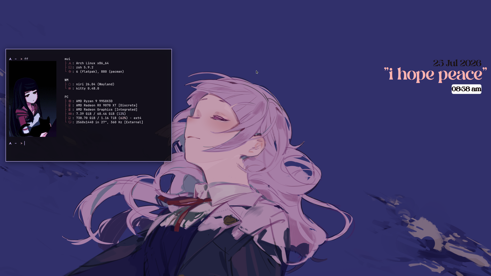
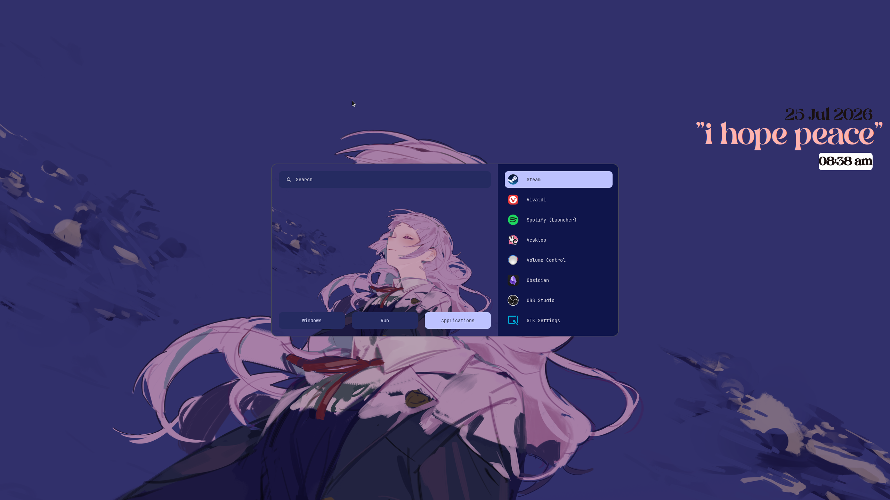

# Niri dotfiles

The dotfiles aren't entirely from me i used some configs from other repos aswell.

For color scheme generation I use Matugen with a script to pick ur wallpaper. 
The setup uses Awww as its wallpaper daemon.

## Screenshots

